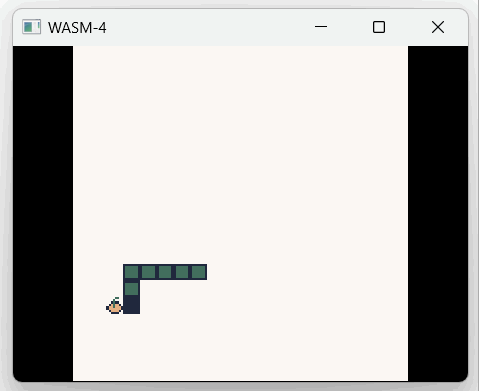
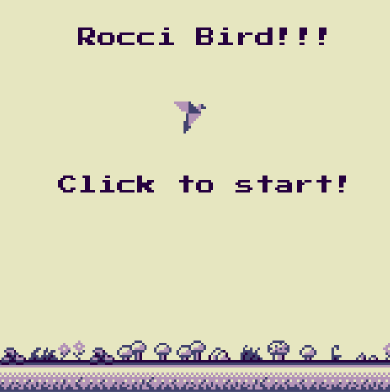
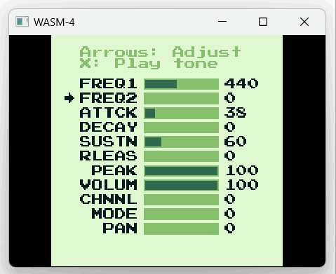
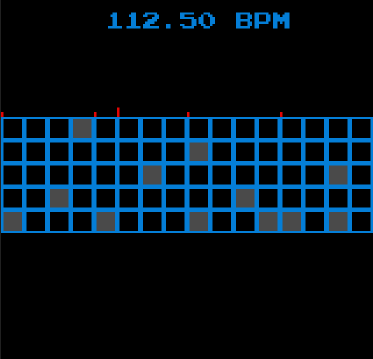

# roc-wasm4

A Roc platform for building [WASM-4](https://wasm4.org) games.

roc-wasm4 gives Roc apps a high-level `W4` API for drawing, input, audio, disk persistence, netplay state, and sprites. Most apps should use a released roc-wasm4 platform bundle directly from GitHub Releases.

## Requirements

- [Roc](https://www.roc-lang.org/install), available as `roc`; use the compiler required by the release you select
- [WASM-4 CLI](https://wasm4.org), available as `w4`
- A roc-wasm4 `.tar.zst` platform bundle URL from the [GitHub Releases page](https://github.com/lukewilliamboswell/roc-wasm4/releases)

## Quick Start

Copy the [basic example](examples/basic/main.roc) into your own application directory.
Checkout examples use the local platform and need [Blueprint](https://github.com/lukewilliamboswell/roc-blueprint/releases/tag/0.11.0) to build its host. For a standalone game, select an
immutable platform bundle from GitHub Releases and follow that release’s
compiler requirements.

Build the example and run it with WASM-4:

```shell
blueprint run build-host
roc build examples/basic/main.roc --target=wasm32 --opt=size --output=basic.wasm
w4 run basic.wasm
```

For the native WASM-4 runtime, use `w4 run-native basic.wasm`. Native can be much slower than the web runtime, especially for non-optimized builds.

## Platform API

The platform exposes:

- `w4.W4` for WASM-4 drawing, input, audio, disk, random, and utility APIs
- `w4.Sprite` for sprite data and blitting helpers
- `w4.Host` for low-level hosted effects, mostly intended for platform internals

The manual and platform API docs are hosted at [lukewilliamboswell.github.io/roc-wasm4/](https://lukewilliamboswell.github.io/roc-wasm4/).

## Examples

This repository includes several example apps:

- `examples/basic/main.roc`: drawing, text, input, mouse, trace, and tone basics
- `examples/snake/main.roc`: a small playable snake game
- `examples/rocci-bird/main.roc`: a Rocci Bird demo by Brendan Hansknecht with art by Luke DeVault
- `examples/sound/main.roc`: a tone parameter playground

Each application lives in its own directory. Copy the whole directory when
starting a game and select the platform dependency for your deployment.

Contributors testing platform source changes can use the local path shown in [CONTRIBUTING.md](CONTRIBUTING.md).

Then build and run the app:

```shell
roc version
roc build examples/snake/main.roc --target=wasm32 --opt=size --output=snake.wasm
w4 run snake.wasm
```



[Play Rocci Bird online](https://bren077s.itch.io/rocci-bird).





Drum Roll is a separate demo by Isaac Van Doren. [Source](https://github.com/isaacvando/roc-drum-machine) and [play online](https://isaacvando.github.io/roc-drum-machine/).



## Game Distribution

For a smaller game cart, build the Roc app with size-oriented optimizations:

```shell
roc build app.roc --target=wasm32 --opt=size --output=app.wasm
```

Bundle the generated cart with the WASM-4 CLI:

```shell
w4 bundle app.wasm --title "My Game" --html my-game.html
```

For native bundles:

```shell
w4 bundle app.wasm --title "My Game" \
    --windows my-game-windows.exe \
    --mac my-game-mac \
    --linux my-game-linux
```

## Contributing

Source-build setup, local checks, docs generation, and release maintenance are covered in [CONTRIBUTING.md](CONTRIBUTING.md).
